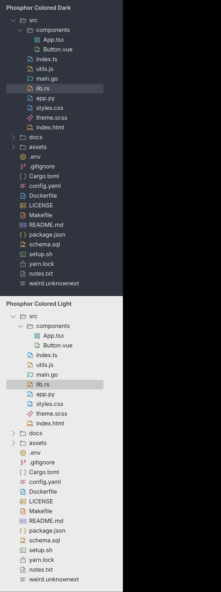
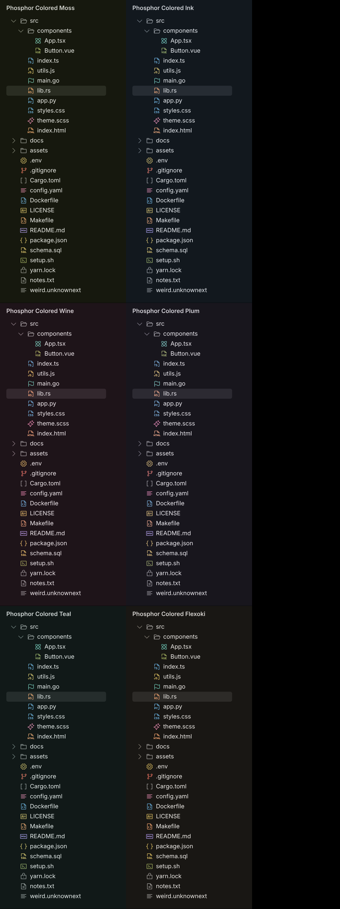

# Phosphor Colored Icons

[Phosphor](https://phosphoricons.com/) file icons for Zed, in color. A fork of [Phosphor Icons Theme](https://github.com/theoluciano/phosphor-icons-theme) by Theo Luciano, which uses one color for every icon.



## Icon themes

- **Phosphor Colored Dark** and **Phosphor Colored Light**: general-purpose sets for any dark or light color theme.
- **Phosphor Colored Moss, Ink, Wine, Plum, Teal, Flexoki**: matched to the syntax colors of the Flexoki Variants color theme (`icon_themes/phosphor-colored-flexoki-variants.json`).



Pick one with the icon theme selector, or in `settings.json`:

```json
"icon_theme": {
  "mode": "system",
  "dark": "Phosphor Colored Dark",
  "light": "Phosphor Colored Light"
}
```

## How the colors work

Each file type gets one color role: red, orange, yellow, green, cyan, blue, purple, magenta or neutral. Roles follow the usual brand color for each language, quantized to eight hues, so TypeScript is blue, Rust orange, JavaScript yellow, and config files like `.toml` stay neutral. Folders and chevrons are neutral so file colors stand out.

The Dark and Light palettes are built in OKLCH with even lightness across hues, so no color jumps out. Every color is at least 3:1 contrast against Zed's One Dark and One Light panels.

Languages that Phosphor has no glyph for (Kotlin, Dart, Elixir and others) share the generic code glyph, but each gets its own color.

## Editing

Icons in `icons/` and the files in `icon_themes/` are generated. Edit these instead, then run `python3 scripts/build.py`:

- `scripts/build.py`: the file type to icon and color role table (`ICONS`).
- `palettes.json`: role to hex color, per palette.
- `glyphs/`: the source SVGs, with `fill="currentColor"`.

To pull new colors from your Zed color theme after changing it:

```sh
python3 scripts/build.py --zed-theme ~/.config/zed/themes/flexoki-variants.json
```

`python3 scripts/build.py --report` prints the contrast of each color against its background. The build also checks that every mapping points to a real icon and no SVG is unused.

## Credits

- Icons from [Phosphor Icons](https://github.com/phosphor-icons/core) (MIT).
- Original Zed icon theme by [Theo Luciano](https://github.com/theoluciano/phosphor-icons-theme) (MIT).
- Inspired by [Colored Zed Icons Theme](https://github.com/TheRedXD/zed-icons-colored-theme) by TheRedXD.

MIT licensed. See `LICENSE`.
